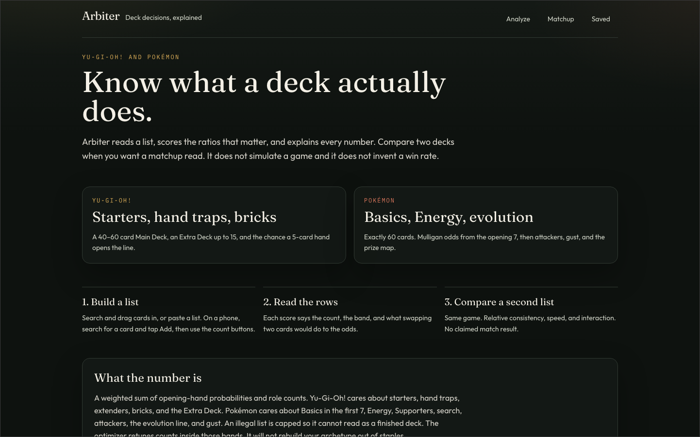
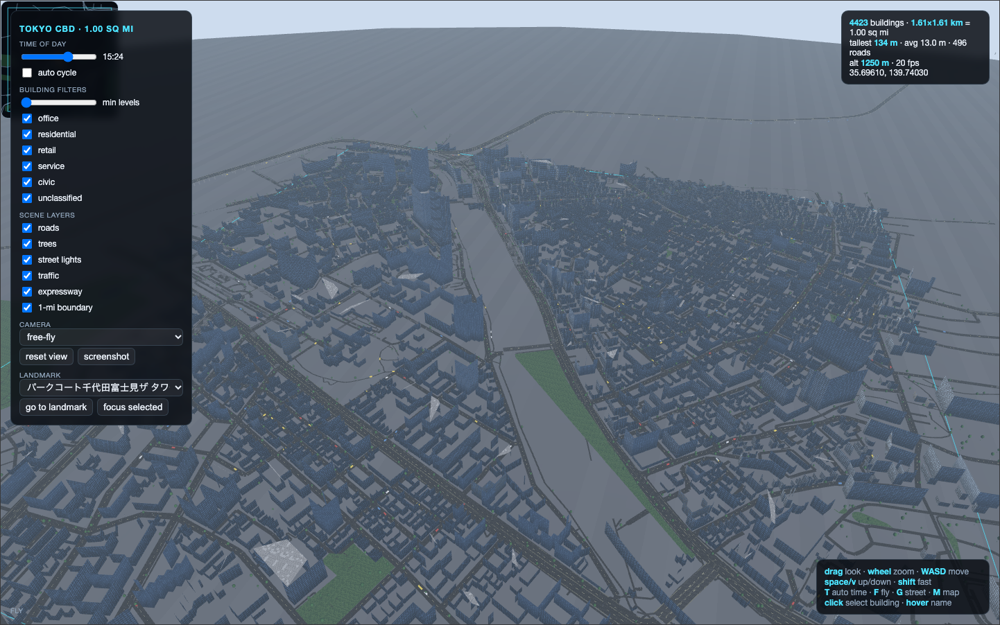
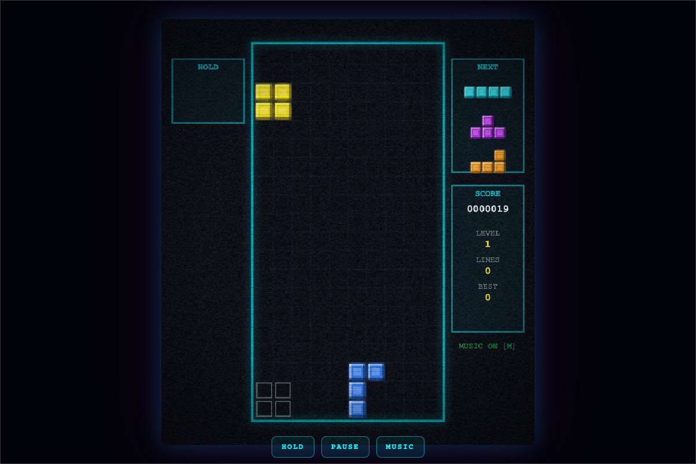

  <b>oherna25</b> &nbsp;&nbsp; <a href="#user-content-now">Work</a> &nbsp;·&nbsp; <a href="#user-content-browser">Play</a> &nbsp;·&nbsp; <a href="#user-content-about">About</a> &nbsp;·&nbsp; <a href="https://github.com/oherna25">GitHub</a>

  <picture>
    <source media="(prefers-color-scheme: dark)" srcset="assets/hero-dark.svg">
    
  </picture>

<strong>First-generation college student. I build apps and games.</strong>

PYTHON &nbsp;·&nbsp; TYPESCRIPT &nbsp;·&nbsp; SWIFT &nbsp;·&nbsp; JAVASCRIPT &nbsp;·&nbsp; HTML &nbsp;·&nbsp; C++ &nbsp;·&nbsp; SQL

  
  &nbsp;&nbsp;
  <a href="https://github.com/oherna25"><b>GitHub profile&nbsp;›</b></a>

Arbiter and DuoBrowser are in active development. Both repositories are private, so the links below go to the public app and the public support page.

<h3 align="center">Arbiter</h3>

Explainable deck decisions for Yu-Gi-Oh! and Pokémon. Build or paste a list, then read a score that says why it landed there: opening-hand odds, role counts, gaps, and specific swaps.

A constraint solver can retune counts without inventing a new archetype. Two lists from the same game can be compared on consistency, interaction, and setup. Arbiter does not play the cards out, and it does not estimate a match win rate.

FastAPI, Next.js, and Python. An unofficial fan tool. Not affiliated with Konami or The Pokémon Company.

<h3 align="center">DuoBrowser</h3>

A multi-screen web browser for the iPhone Duo, written in SwiftUI and WebKit. It keeps three independent sessions — cover, inner left, and inner right — with badges for which screen a page belongs to, a live map of the layout, and bookmarks that can restore every panel at once.

An ephemeral mode clears cookies, storage, and history when the app leaves the foreground.

iOS 17 and later.

<h3 align="center">Tokyo, 1.00 sq mi</h3>

One square mile of downtown Tokyo, centered on Shimbashi, as an interactive 3D model in a single HTML file.

Building footprints, streets, parks, and the elevated expressway come from OpenStreetMap: about 4,400 buildings, not a procedural stand-in. Orbit the district, walk it at street level, or switch to a map, then click a building for its name and height.

  
  &nbsp;&nbsp;
  <a href="https://github.com/oherna25/tokyo-1sqmi"><b>Source&nbsp;›</b></a>

<h3 align="center">Tetris Retro</h3>

Tetris in one HTML file. Film grain, scanlines, procedural chiptune, and neon CRT blocks. It uses a 7-bag randomizer, hold, a ghost piece, and stores a best score in the browser. Keyboard on a desktop, swipe on a phone.

  
  &nbsp;&nbsp;
  <a href="https://github.com/oherna25/tetris-retro"><b>Source&nbsp;›</b></a>

  <a href="https://github.com/oherna25/ai201-project4-provenance-guard"><b>Provenance Guard</b></a> 
  AI 201 project. A Flask service that labels text as human-written or AI-generated, keeps an audit log, and accepts an appeal.

  <a href="https://github.com/oherna25/Hernande_Iwaki_MorseCodeMachine"><b>Morse code machine</b></a> 
  C++ and Arduino Morse translator, built with a partner.

  <a href="https://github.com/oherna25/Wearables-Glove-Lab"><b>Wearables glove lab</b></a> 
  Processing sketches from a wearable-glove lab.

  <a href="https://oherna25.github.io/apple-landing/"><b>Landing page</b></a> 
  A short index of the same work, in an Apple-inspired layout.

<h3 align="center">About</h3>

First-generation college student and CS hopeful. I love coding apps and games, from browser games to hardware projects.

On GitHub since 2021. Open to collaborating on apps and games.

oherna25 &nbsp;·&nbsp; <a href="https://github.com/oherna25">GitHub</a> &nbsp;·&nbsp; 2026

